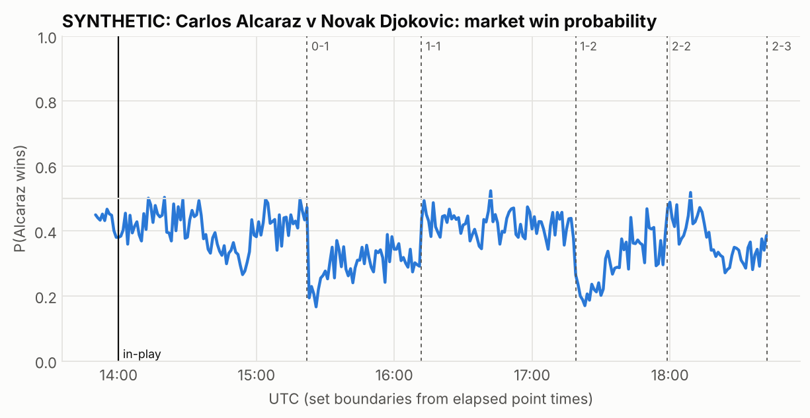

# Phase 0: setup and data audit

> **Status: pipeline complete and tested; real-data audit pending.** The figure below
> comes from the **synthetic** test fixture (`tests/fixtures/`), not from a real
> match. Run the commands at the bottom once the raw data is in `data/raw/`.

## What exists

| Piece | Module | Test |
|---|---|---|
| Score state machine (tiebreaks, best-of-3/5, four final-set rules) | `courtedge.markov.score` | `tests/test_score.py` |
| Sackmann slam + tour point-by-point parser | `courtedge.data.pbp` | `tests/test_pbp.py` |
| Betfair BASIC stream parser (bz2 / dir / tar) | `courtedge.data.betfair` | `tests/test_betfair.py` |
| Cross-source catalogue (fuzzy surnames + dates) | `courtedge.data.catalogue` | `tests/test_catalogue.py` |
| Point clock times (ElapsedTime, else estimated) | `courtedge.data.align` | `tests/test_align.py` |

The point-by-point parser rebuilds the score itself and cross-checks it against the
upstream server column and winner. Each disagreement goes into
`matches.parse_issues`, so problem matches are visible rather than silently dropped.

## Market trace (synthetic fixture)



## To finish the audit on real data

```bash
scripts/download_data.sh                      # Sackmann repos
# + Betfair BASIC tennis .tar for one Grand Slam month in data/raw/betfair/
uv run python scripts/build_catalogue.py \
    --slam data/raw/tennis_slam_pointbypoint/2023-wimbledon-points.csv \
    --betfair data/raw/betfair --out data/interim --catalogue data/catalogue.csv
uv run python scripts/plot_market_trace.py
```

Done when `data/catalogue.csv` has ≥ 3 linked matches with `match_confidence` ≥ 0.8
and 3-5 of them have a `video_path` filled in.
