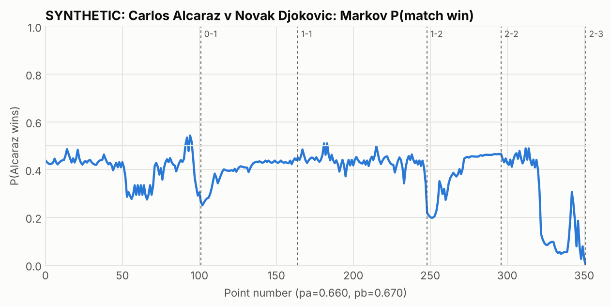

# Phase 1: Markov win-probability engine

Points are modelled as independent given the server: `pa` = P(A wins a point on serve),
`pb` = P(B wins a point on serve). The engine (`courtedge.markov.engine`, ported to C++ in
`cpp/src/markov.cpp`) returns P(A wins) the current game, set and match from any score.
It covers best-of-3/5 and all four deciding-set rules (7-point tiebreak at 6-6, advantage,
tiebreak at 12-12, 10-point tiebreak at 6-6).

Game closed form: `P_game(0.6) = 0.7357` (spec check: about 0.736).

## Engine vs Monte Carlo

100,000 simulations per cell, `pa` in [0.5, 0.55, 0.6, 0.65, 0.7, 0.75], `pb = 0.62`. Tolerance 0.005.
Simulator: C++ (`courtedge._core.simulate`).

| State | max abs error: game | set | match |
|---|---|---|---|
| Bo3, 0-0 | 0.0029 | 0.0017 | 0.0018 |
| Bo3, deuce, B serving | 0.0017 | 0.0025 | 0.0040 |
| Bo3, tiebreak 5-5 | 0.0019 | 0.0019 | 0.0021 |
| Bo5 super-TB, 2-2 sets | 0.0017 | 0.0024 | 0.0024 |
| Bo5 advantage, 2-2 sets, 6-6 | 0.0013 | 0.0014 | 0.0014 |
| Bo5 TB at 12-12, 2-2 sets | 0.0026 | 0.0015 | 0.0015 |

Worst error over the grid: **0.0040** (PASS).
One Monte Carlo standard error at p = 0.5 is 0.0016.

Other checks in `tests/test_markov.py` and `cpp/tests/test_markov.cpp`:

- **Martingale identity** at every state of a replayed match and along long random walks:
  P(now) = q·P(after A wins point) + (1-q)·P(after B wins point), to 1e-12. The next
  states come from the separate score state machine, so this ties the engine to the
  scoring rules exactly.
- **Python/C++ parity** on 5,593 random states, to 1e-10.
- Symmetry (swap players) and equal players giving 0.5 under every format.

## Speed

| Operation | Time |
|---|---|
| Python, first query for a new (pa, pb) | 0.60 ms |
| Python, repeat query (memoised) | 8.6 µs |
| C++ engine construction via Python | 15.5 µs |
| C++ query via Python (includes binding overhead) | 0.29 µs |

C++ benchmarks: `./build/courtedge_bench` (Google Benchmark).

## Match trace

The trace above uses the **synthetic** fixture match. To plot a real match after Phase 0:
`uv run python scripts/plot_match_trace.py --match-id <id>`.
