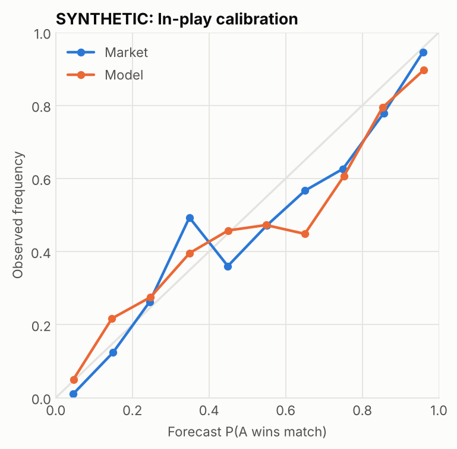
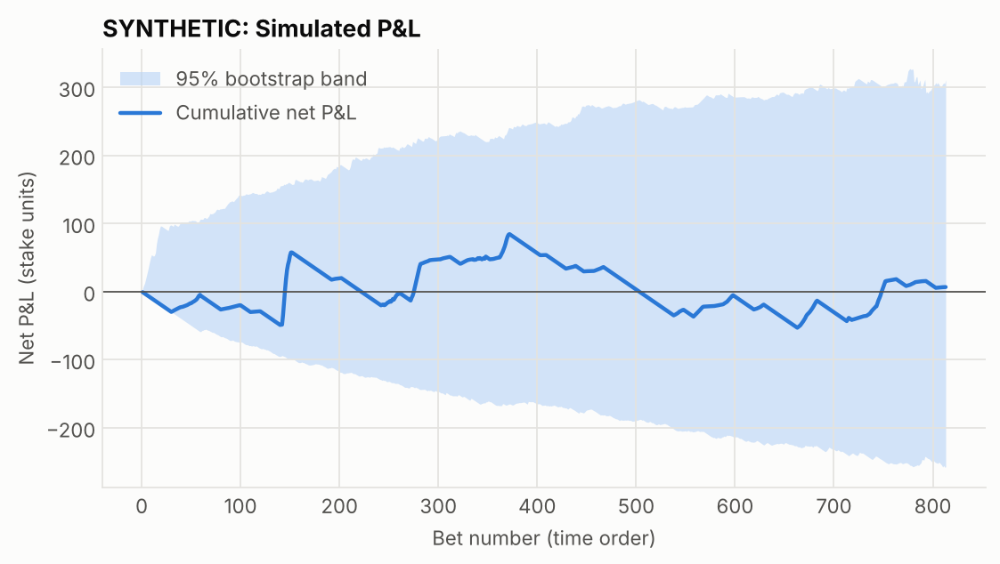

# SYNTHETIC: Phase 2: odds-only backtest

> **SYNTHETIC DATA.** Every number below comes from the generated demo world
> (`scripts/make_demo_data.py`), not from real Betfair prices. It exercises the
> pipeline end to end. Regenerate this report from real data before quoting it.

## Setup

- Matches: **96** used of 96 in the catalogue; 19,526 in-play decision ticks; point timing: {'elapsed': 96}.
- Model: Markov engine on pre-match serve probabilities (52-week, surface-shrunk, opponent-adjusted) with the score known at **t - 60 s**.
- Market: last traded prices de-vigged (multiplicative).
- Strategy: back when |model - market| > 0.05, flat staking, 1 tick slippage, at most 10 bets per market, 300 s apart.
- Commission: per-market `marketBaseRate` from the Betfair files (range 5.0%-5.0%; fallback 5%). It is charged on net market winnings.
- Bootstrap: 1000 resamples of whole matches. Backtest engine: C++ core.

## Forecast accuracy (in-play, P(A wins match))

| Forecast | Metric | Value [95% CI] |
|---|---|---|
| Market (de-vigged LTP) | Brier | 0.1560 [0.1196, 0.1943] |
| Market (de-vigged LTP) | Log loss | 0.4655 [0.3719, 0.5675] |
| Model (Markov, delayed) | Brier | 0.1775 [0.1365, 0.2185] |
| Model (Markov, delayed) | Log loss | 0.5240 [0.4193, 0.6309] |
| Model - market | Brier | 0.0215 [-0.0002, 0.0455] |

ECE: market 0.0593, model 0.0660. At the first in-play tick: Brier market 0.1640, model 0.2032 (n = 96).

## Simulated P&L

| Bets | Matches with bets | Staked | Commission | Net | ROI [95% CI] |
|---|---|---|---|---|---|
| 813 | 87 | 813.00 | 22.79 | 6.50 | 0.008 [-0.322, 0.383] |

## Serve-estimate diagnostic (synthetic only)

Estimated vs true serve-point probability: RMSE **0.0313**, bias -0.0049. The demo market's skill error has RMSE 0.0115. The market knows each match's form and the stats model does not, so the model should lose to the market here.

## Limitations

- BASIC data: one-minute last traded prices, no volume or order book. Fills at LTP minus a slippage tick are optimistic for larger stakes.
- Point timing is `elapsed` (Sackmann ElapsedTime anchored at the in-play minute, so up to ±60 s of anchor error) or `estimated` (spread between in-play start and suspension, which uses the match end time). Phase 4 replaces both with video alignment.
- Thresholds and staking were fixed in `configs/backtest.yaml` before running. Any other configuration tried must be added to this report.

Config: `configs/backtest.yaml`. Full parameters: `{'delay_s': 60, 'threshold': 0.05, 'commission': None, 'slippage_ticks': 1, 'devig_method': 'multiplicative', 'min_gap_s': 300, 'max_bets': 10, 'min_odds': 1.05, 'max_odds': 20.0, 'trade_preplay': False, 'staking': {'rule': 'flat', 'stake': 1.0, 'bankroll': 100.0, 'kelly_fraction': 0.25, 'kelly_cap': 0.02}}`
